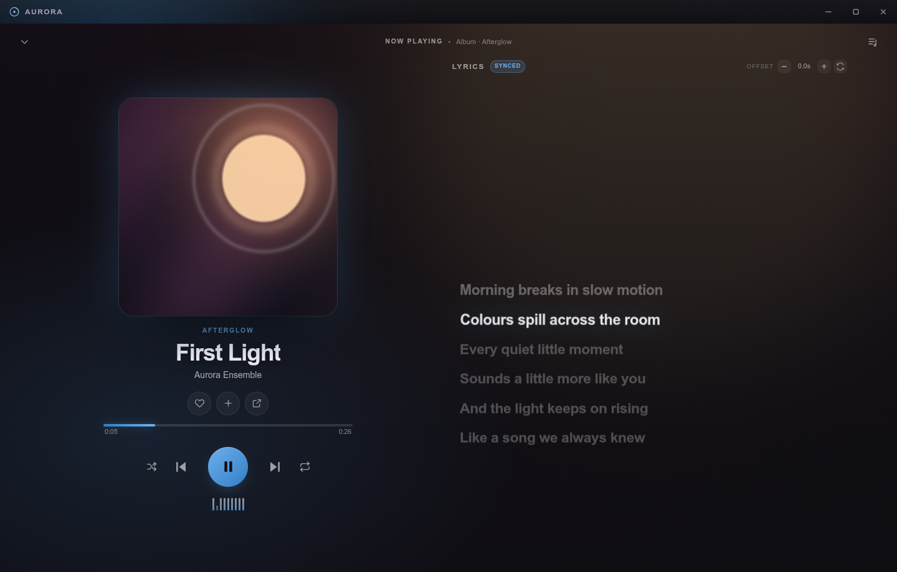
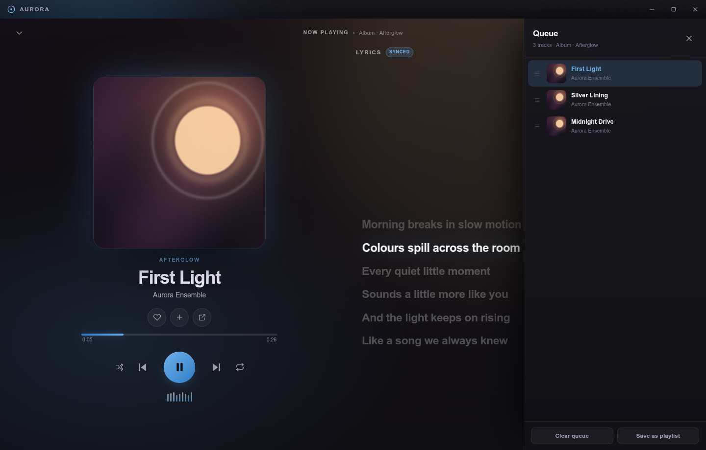
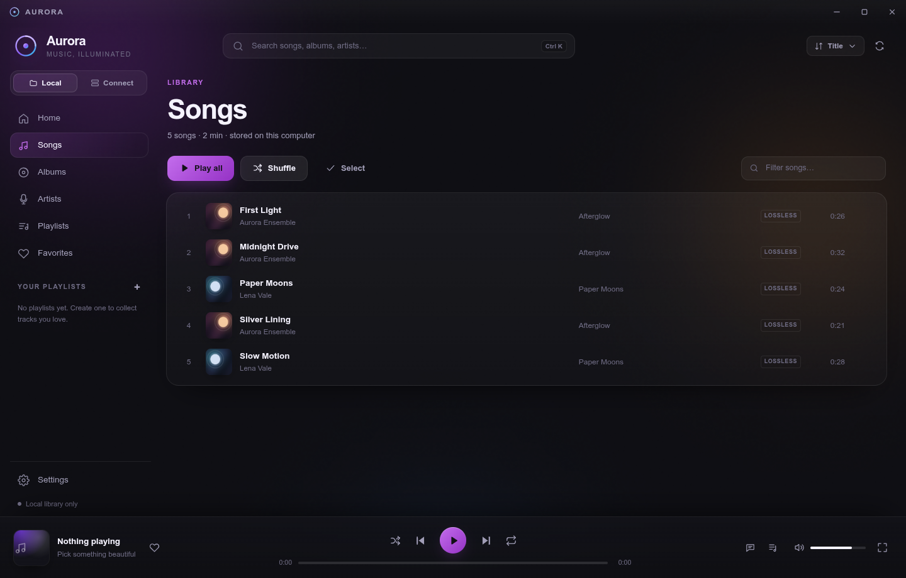
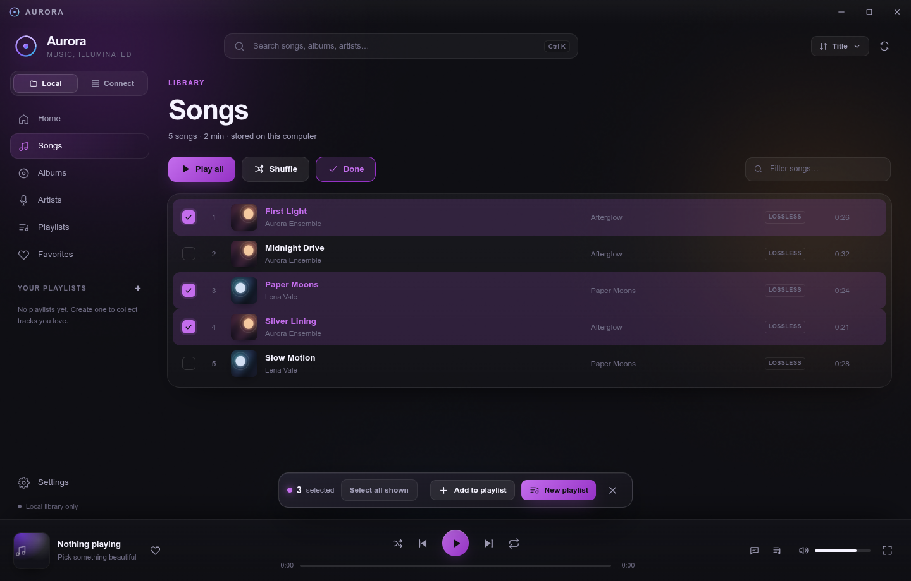

# Aurora Music

<p align="center">
  
</p>

<p align="center">
  <strong>یک پخش‌کنندهٔ موسیقی دسکتاپ زیبا، با لیریک همگام و پشتیبانی از سرورهای Subsonic</strong><br />
  A beautiful desktop music player with synced lyrics and Subsonic support.
</p>

<p align="center">
  
</p>

<p align="center">
  
</p>

<p align="center">
  
</p>

<p align="center">
  
</p>

---

## فارسی

### دربارهٔ Aurora

Aurora یک پخش‌کنندهٔ موسیقی رومیزی است که با Electron ساخته شده و از دو منبع موسیقی پشتیبانی می‌کند:

- **کتابخانهٔ محلی** — پوشه‌های موسیقی روی کامپیوتر شما (MP3، FLAC، M4A، AAC، OGG، Opus، WAV، AIFF، WMA و…)
- **سرور سازگار با Subsonic** — Navidrome، Subsonic، Airsonic، Gonic، Ampache و مشابه آن‌ها

رابط کاربری الهام‌گرفته از Feishin است: پنجرهٔ واقعی دسکتاپ، تم‌های تیره، رنگ تأکیدی که با هر آلبوم تغییر می‌کند، پس‌زمینهٔ زنده و تجربهٔ لیریک تمام‌صفحه.

### ویژگی‌ها

- 🎧 **دو منبع در یک برنامه** — کتابخانهٔ محلی و سرور Subsonic، با جابه‌جایی یک‌کلیکی
- 🎤 **لیریک همگام** — فایل‌های `.lrc` کنار آهنگ، لیریک داخل تگ‌ها، و OpenSubsonic `getLyricsBySongId`
- ✨ **کارائوکهٔ کلمه‌به‌کلمه** — پشتیبانی از تگ‌های `<mm:ss.xx>` در LRC و هایلایت هم‌زمان با صدا
- 🎚️ **تنظیم آفست لیریک** — جلو/عقب بردن لیریک با گام‌های کوچک
- 💿 **آلبوم، هنرمند، پلی‌لیست، علاقه‌مندی‌ها** — با صفحه‌های جزئیات کامل و کاورهای باکیفیت
- 🎵 **صفحهٔ همهٔ آهنگ‌ها** — دیدن کل کتابخانه در یک صفحه، با مرتب‌سازی و فیلتر زنده
- ✅ **انتخاب گروهی** — انتخاب چند آهنگ و افزودن یک‌جای آن‌ها به پلی‌لیست
- 🧩 **مدیریت آسان پلی‌لیست** — افزودن آهنگ با جست‌وجو و جابه‌جایی با کشیدن و رها کردن
- 🔍 **جست‌وجوی زنده** — آهنگ، آلبوم و هنرمند
- 📃 **صف پخش** — افزودن به صف، پخش بعدی، حذف، جابه‌جایی و ذخیرهٔ خودکار
- 🔀 **شافل و تکرار** — تکرار همه / تکرار یک
- 🎨 **سه تم** — Midnight، Slate و Rose؛ همراه با رنگ تأکیدی خودکار بر اساس آلبوم
- 🖥️ **یکپارچگی با سیستم** — کنترل از طریق کلیدهای رسانه‌ای، MediaSession و منوی دسکتاپ
- 💾 **حفظ وضعیت** — آهنگ، صف، ولوم و صفحهٔ آخر بعد از بستن برنامه بازمی‌گردند
- 📦 **نصب‌کنندهٔ آماده** — AppImage و DEB برای لینوکس (و تنظیمات ساخت برای ویندوز و مک)

### نصب و اجرا

پیش‌نیاز: **Node.js 20 یا جدیدتر** و npm.

```bash
cd project
npm install
npm start
```

اگر برنامه روی لینوکس با خطای sandbox بالا نیامد (به‌خصوص در برخی توزیع‌ها یا محیط‌های مجازی):

```bash
npm run start:unsafe
```

### ساخت نسخهٔ نصب‌شدنی

```bash
npm run dist:linux     # AppImage + DEB
# یا برای ویندوز / مک:
npm run dist:win
npm run dist:mac
```

خروجی‌ها در پوشهٔ `dist/` ساخته می‌شوند. برای لینوکس:

- `dist/Aurora-1.0.0.AppImage`
- `dist/aurora-music_1.0.0_amd64.deb`

اجرای AppImage:

```bash
chmod +x dist/Aurora-1.0.0.AppImage
./dist/Aurora-1.0.0.AppImage
```

نصب DEB:

```bash
sudo dpkg -i dist/aurora-music_1.0.0_amd64.deb
```

> اگر AppImage روی سیستم شما به‌دلیل sandbox اجرا نشد، از `./dist/Aurora-1.0.0.AppImage --no-sandbox` استفاده کنید.

### ساخت نسخهٔ ویندوز

**روش ۱ — روی ویندوز (پیشنهادی و مطمئن‌ترین):**

1. [Node.js LTS](https://nodejs.org) را روی ویندوز نصب کنید.
2. پوشهٔ پروژه را روی ویندوز کپی کنید (پوشه‌های `node_modules` و `dist` لازم نیستند).
3. در PowerShell داخل پوشهٔ پروژه اجرا کنید:

```powershell
npm install
npm run dist:win
```

4. فایل نصب در مسیر `dist\Aurora-Setup-1.0.0.exe` ساخته می‌شود.

**روش ۲ — ساخت از لینوکس با Wine:**

ساخت نصب‌کنندهٔ NSIS در لینوکس به Wine نیاز دارد:

```bash
sudo apt install wine64
npm run dist:win
```

**روش ۳ — نسخهٔ پرتابل بدون نصب (بدون نیاز به Wine):**

```bash
npm run dist:win:zip
```

خروجی `dist/Aurora-1.0.0-win.zip` است. آن را استخراج کنید و `Aurora.exe` را اجرا کنید. این نسخه نصب‌کننده ندارد اما کامل و قابل حمل است.

> نسخهٔ فعلی در همین پروژه ساخته شده است: `dist/Aurora-1.0.0-win.zip` (حدود ۱۴۷ مگابایت).
>
> چون برنامه امضای دیجیتال ندارد، ویندوز ممکن است پیام SmartScreen نشان دهد؛ روی **More info → Run anyway** بزنید.

### افزودن موسیقی

1. از نوار کناری به **Settings** بروید.
2. در بخش **Music library** روی **Add folder** بزنید و پوشهٔ موسیقی را انتخاب کنید.
3. **Rescan** را بزنید. زیرپوشه‌ها هم اسکن می‌شوند.

Aurora کاور آلبوم را از فایل‌های `cover.jpg` / `cover.png` / `folder.jpg` و همچنین کاور داخل تگ‌ها می‌خواند.

### اتصال به سرور Subsonic

در **Settings → Music server** آدرس کامل سرور (با `http://` یا `https://`)، نام کاربری و رمز عبور را وارد کنید، سپس **Save & connect**. دکمهٔ **Test connection** قبل از ذخیره، اتصال را بررسی می‌کند.

جریان صدا و کاورها از طریق پروتکل داخلی `aurora://` و پروکسی برنامه رد می‌شوند؛ بنابراین رمز عبور در رابط کاربری ذخیره یا نمایش داده نمی‌شود و مشکل mixed-content پیش نمی‌آید.

### لیریک

Aurora به ترتیب این منابع را امتحان می‌کند:

1. فایل `.lrc` هم‌نام کنار آهنگ (مثلاً `01 - First Light.lrc`)
2. لیریک داخل تگ‌های فایل صوتی
3. OpenSubsonic `getLyricsBySongId` روی سرور
4. `getLyrics` قدیمی‌تر Subsonic

برای لیریک همگام، زمان‌ها را به شکل `[mm:ss.xx]` بنویسید. برای کارائوکهٔ کلمه‌به‌کلمه، داخل هر خط از تگ‌هایی مثل `<00:12.40>` استفاده کنید.

در صفحهٔ Now Playing دکمه‌های `−` و `+` برای تنظیم آفست لیریک در دسترس‌اند.

### کلیدهای میانبر

| کلید | عملکرد |
| --- | --- |
| `Space` | پخش / توقف |
| `→` / `←` | جلو / عقب ۵ ثانیه |
| `Shift + →` / `Shift + ←` | آهنگ بعدی / قبلی |
| `↑` / `↓` | کم و زیاد کردن ولوم |
| `0` – `9` | پرش به درصدی از آهنگ |
| `S` | شافل |
| `R` | تغییر حالت تکرار |
| `F` | افزودن/حذف علاقه‌مندی |
| `L` | باز کردن لیریک |
| `Q` | نمایش/پنهان کردن صف |
| `M` | بی‌صدا |
| `Ctrl / ⌘ + K` | جست‌وجو |
| `Esc` | بستن پنجرهٔ باز |

### محل ذخیرهٔ داده‌ها

تنظیمات، کتابخانه، پلی‌لیست‌ها و علاقه‌مندی‌ها در پوشهٔ دادهٔ برنامه ذخیره می‌شوند:

- **لینوکس:** `~/.config/Aurora/aurora-data/`
- **ویندوز:** `%APPDATA%/Aurora/aurora-data/`
- **مک:** `~/Library/Application Support/Aurora/aurora-data/`

از دکمهٔ **Data folder** در Settings می‌توانید پوشه را مستقیماً باز کنید.

### توسعه و تست

```bash
npm run demo   # ساخت کتابخانهٔ نمونه در /tmp/aurora-music
npm run mock   # اجرای یک سرور Subsonic ساختگی روی http://127.0.0.1:4599
```

برای اجرای برنامه با کتابخانهٔ نمونه:

```bash
AURORA_USER_DATA=/tmp/aurora-userdata AURORA_SCAN=1 npm start
```

و برای اتصال به سرور ساختگی، آدرس `http://127.0.0.1:4599` با نام کاربری و رمز `demo` را در Settings وارد کنید.

---

## English

### About

Aurora is an Electron desktop music player inspired by Feishin. It plays music from local folders **and** Subsonic-compatible servers (Navidrome, Subsonic, Airsonic, Gonic, Ampache…), with a focus on a polished dark interface and a first-class lyrics experience.

### Features

- Local library and Subsonic server support in one app
- Synced lyrics from sidecar `.lrc` files, embedded tags, and OpenSubsonic
- Word-by-word karaoke highlighting (LRC `<mm:ss.xx>` word tags)
- Lyrics offset controls
- Albums, artists, playlists, favorites, live search
- All Songs page with sorting, live filtering, and multi-select bulk actions
- Fast playlist building — searchable Add songs picker and drag-to-reorder tracks
- Persistent queue with play-next, reorder, and remove
- Shuffle, repeat all, repeat one
- Three themes and per-album automatic accent colours
- Ambient reactive background, reduced-motion option
- Media keys, MediaSession, desktop integration
- Restores the last track, queue, volume, and route on launch
- Linux AppImage and DEB packaging, plus Windows/macOS build configs

### Install & run

Requires **Node.js 20+**.

```bash
npm install
npm start
# if Electron's sandbox is unavailable on your system:
npm run start:unsafe
```

### Build installers

```bash
npm run dist:linux   # dist/Aurora-1.0.0.AppImage, dist/aurora-music_1.0.0_amd64.deb
npm run dist:win
npm run dist:mac
```

### Build for Windows

**Recommended — build on Windows.** Install Node.js LTS, copy the project, then run:

```powershell
npm install
npm run dist:win
```

The installer is written to `dist\Aurora-Setup-1.0.0.exe`.

**Cross-building from Linux** requires Wine for the NSIS target:

```bash
sudo apt install wine64
npm run dist:win
```

**Portable build with no installer and no Wine:**

```bash
npm run dist:win:zip
```

This produces `dist/Aurora-1.0.0-win.zip`. Extract it and run `Aurora.exe`. The current project already includes this portable build.

Windows SmartScreen may warn because the build is unsigned — choose **More info → Run anyway**.

### Add music

Open **Settings → Music library → Add folder**, pick a folder, then press **Rescan**. Nested folders are scanned, and `cover.jpg` / `cover.png` / `folder.jpg` (or embedded art) is used for album covers.

### Connect a server

Open **Settings → Music server**, enter the full URL (including `http://` or `https://`), username, and password, then **Save & connect**. Audio and artwork are proxied through the app's `aurora://` protocol so credentials never reach the renderer and mixed-content/CORS issues are avoided.

### Lyrics

Aurora tries, in order: a sidecar `.lrc` file with the same basename, embedded lyrics tags, OpenSubsonic `getLyricsBySongId`, and legacy `getLyrics`. Use `[mm:ss.xx]` timestamps for synced lines and `<mm:ss.xx>` tags inside a line for word-level karaoke.

### Data folder

- **Linux:** `~/.config/Aurora/aurora-data/`
- **Windows:** `%APPDATA%/Aurora/aurora-data/`
- **macOS:** `~/Library/Application Support/Aurora/aurora-data/`

Settings, library metadata, playlists, and favorites are stored there as JSON. The **Data folder** button in Settings opens it.

### Development

```bash
npm run demo   # generate a demo library in /tmp/aurora-music
npm run mock   # run a mock Subsonic server on http://127.0.0.1:4599
AURORA_USER_DATA=/tmp/aurora-userdata AURORA_SCAN=1 npm start
```

---

<p align="center"><sub>Aurora 1.0.0 — built with Electron, vanilla JS and a lot of care for lyrics.</sub></p>
